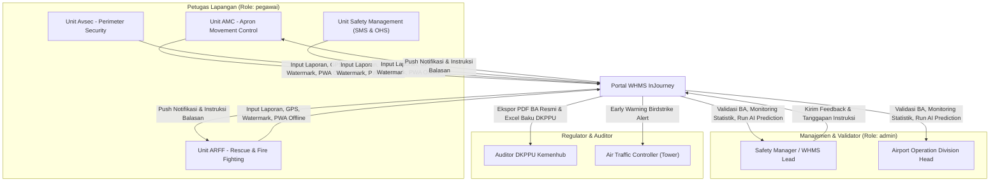
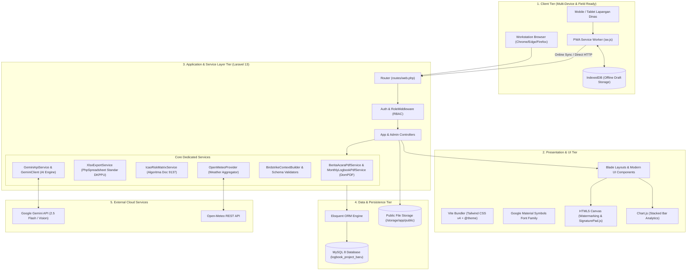
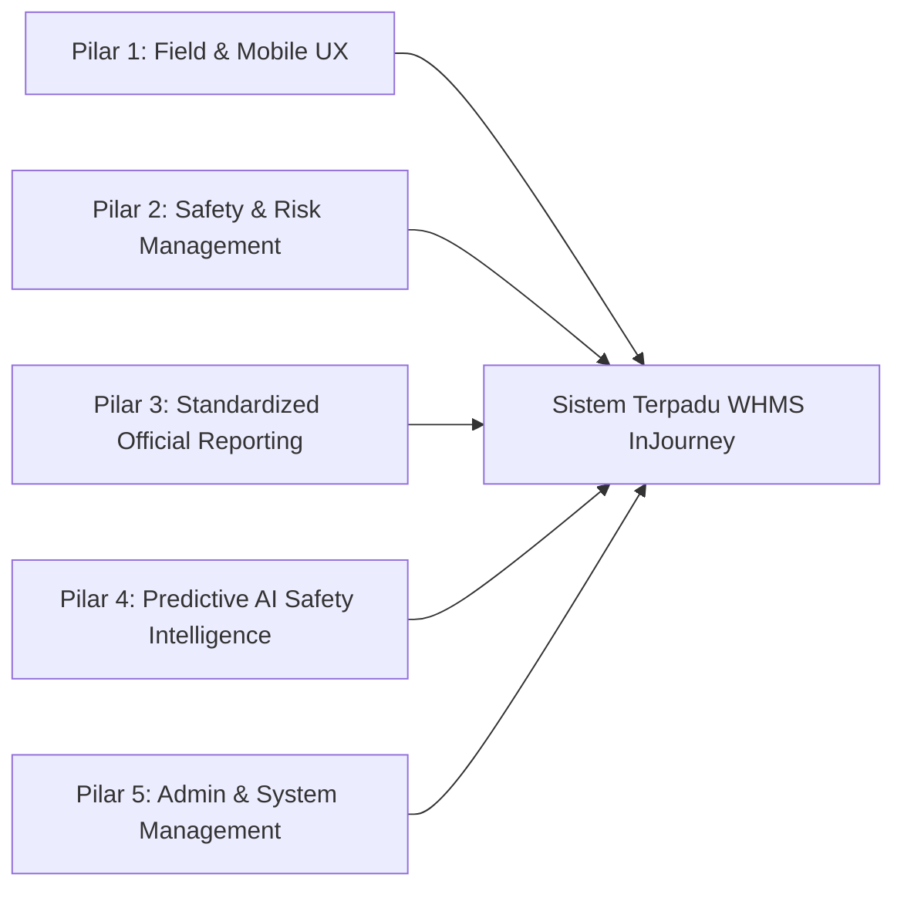
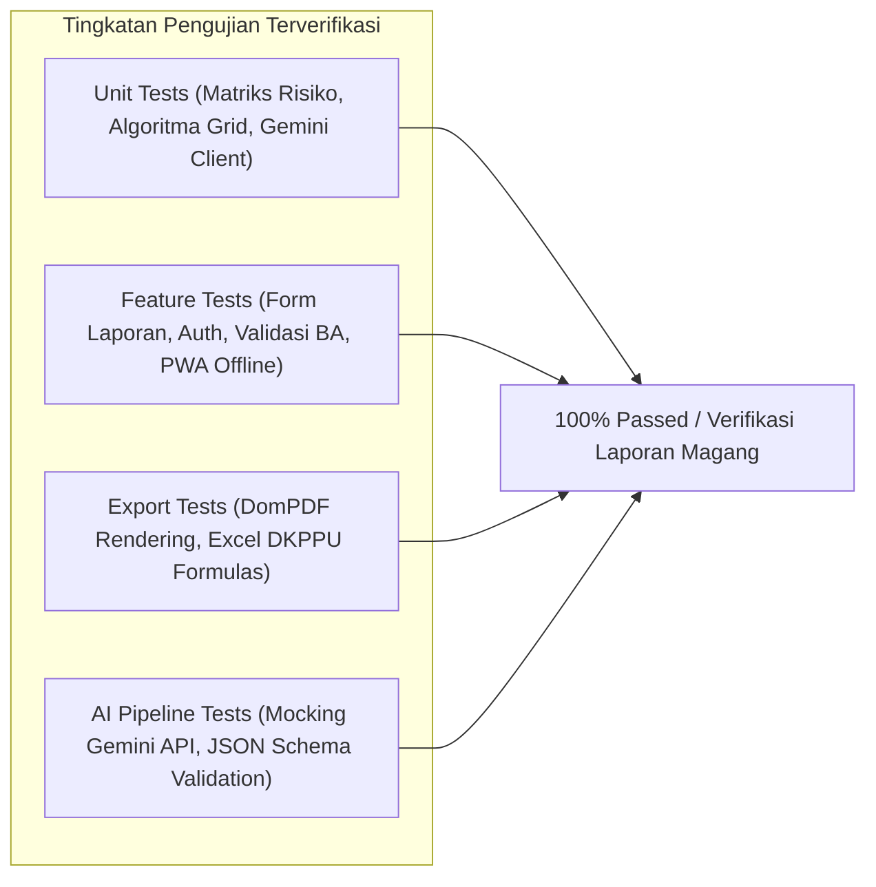

# DOKUMEN SPESIFIKASI KEBUTUHAN PRODUK & TEKNIS (PRD & TECHNICAL SPECIFICATION)
## Wildlife Hazard Management System (Portal Satwa Liar Sisi Udara)
### PT Angkasa Pura Indonesia — InJourney Airports
**Sistem Terpadu Pelaporan Lapangan, Penilaian Risiko ICAO, Kecerdasan Buatan Prediktif Birdstrike (Google Gemini API), & Pelaporan Baku Kelaikudaraan**

---

## 1. Identitas Dokumen & Metadata Sistem

| Parameter Dokumen | Informasi Spesifikasi |
| :--- | :--- |
| **Nama Produk / Sistem** | Wildlife Hazard Management Logbook System (Portal Satwa Liar) |
| **Instansi / Penyelenggara**| PT Angkasa Pura Indonesia (InJourney Airports) |
| **Konteks Operasional** | Divisi Operasi Bandara (*Airside Operations*), Unit AMC, ARFF, Avsec/Perimeter, SMS & OHS |
| **Versi Dokumen** | 2.0-FINAL (Edisi Komprehensif Laporan Magang) |
| **Framework & Runtime** | Laravel 13.x (PHP 8.5+), Node.js v24.x |
| **Frontend Stack** | Blade Templates, Tailwind CSS v4, Vite 8.x, Vanilla JS ES6+, Google Material Symbols |
| **Basis Data** | MySQL 8.0+ / MariaDB (Engine: InnoDB, Charset: utf8mb4) |
| **Mesin Ekspor** | `barryvdh/laravel-dompdf` (Native PDF), `phpoffice/phpspreadsheet` (Standar DKPPU XLSX) |
| **Mesin AI Eksternal** | Google Gemini API (Gemini 2.5 Flash / 1.5 Pro & Gemini Multimodal Vision) |
| **Layanan Cuaca** | Open-Meteo Weather API Integration |
| **Regulasi Rujukan** | • **ICAO Annex 14** (*Aerodrome Design and Operations*) Bab 9<br>• **ICAO Doc 9137 Part 3** (*Airport Services Manual: Wildlife Control and Reduction*)<br>• **Peraturan Direktur Jenderal Perhubungan Udara (KP Ditjen Hubud / DKPPU)** tentang Pengelolaan Bahaya Akibat Satwa Liar di Bandar Udara |

---

## 2. Executive Summary & Visi Produk

Keberadaan satwa liar (*wildlife hazard*) seperti burung migran (*avian flock*), biawak, anjing liar, dan ular di area kritis sisi udara (*runway*, *taxiway*, *apron*, dan saluran drainase perimeter) merupakan ancaman langsung terhadap keselamatan operasional penerbangan (*flight safety*). Insiden tabrakan pesawat dengan satwa (*wildlife / bird strike*) dapat mengakibatkan kerusakan struktur pesawat (*engine ingestion*, keretakan kaca kokpit, kerusakan radar *nose cone*) hingga potensi bahaya fatal terhadap penumpang.

Sistem **Wildlife Hazard Management System (WHMS)** dibangun untuk mentransformasikan proses pemantauan satwa yang sebelumnya bersifat manual, sporadis, dan pasif-reaktif menjadi platform terpadu yang **digital, terstandarisasi, berbasis risiko kuantitatif, dan berorientasi prediktif proaktif**. 

Sistem ini mengintegrasikan seluruh alur kerja operasional bandara:
1. **Penginputan Lapangan yang Tangguh**: Memfasilitasi petugas patroli dengan fitur *Progressive Web App* (PWA) yang dapat bekerja tanpa sinyal internet (*offline-first* di ujung landas pacu), deteksi lokasi otomatis dari sensor GPS ke koordinat Grid Bandara, dan kamera bukti ber-*watermark* dinas.
2. **Kepatuhan Terhadap Standar Internasional**: Mengotomatiskan penilaian bahaya satwa menggunakan matriks risiko **ICAO Doc 9137** secara real-time dan membuka komunikasi dua arah (*feedback loop*) antara pimpinan keselamatan (*Safety Manager*) dengan personil di lapangan.
3. **Standarisasi Dokumen Siap Audit**: Menghasilkan lembar Berita Acara resmi PDF A4 ber-stempel digital dan berkas spreadsheet rekapitulasi audit kelaikudaraan sesuai pedoman baku Direktorat Kelaikudaraan dan Pengoperasian Pesawat Udara (DKPPU).
4. **Penerapan Kecerdasan Buatan Mutakhir**: Memanfaatkan **Google Gemini API** untuk memprediksi probabilitas terjadinya insiden *birdstrike* berdasarkan data historis, tren pergerakan satwa, kepadatan jadwal penerbangan, dan variabel cuaca, serta menyediakan asisten identifikasi taksonomi spesies dan rekomendasi SOP pengusiran otomatis melalui visi komputer (*Gemini Vision*).

---

## 3. Latar Belakang Masalah (Problem Statement)

Sebelum sistem ini diimplementasikan, operasional pengelolaan satwa liar di bandara menghadapi empat tantangan utama:

1. **Pencatatan Fragmented & Risiko Kehilangan Data**: Laporan inspeksi dicatat dalam formulir kertas fisik atau grup pesan singkat (*WhatsApp*) yang rawan tercecer, sulit ditelusuri kembali (*untraceable*), dan tidak memiliki format penomoran resmi (*audit trail* dinas).
2. **Ketiadaan Pemetaan Spasial Presisi**: Penulisan lokasi satwa sering kali bersifat ambigu (misal: "dekat rumput runway"), sehingga tim pengendali satwa (*dispersal team*) sulit memetakan zona rawan (*hotspot zones*) secara akurat.
3. **Analisis Tren yang Lambat & Pasif**: Identifikasi musim migrasi satwa dan spesies dominan memerlukan rekapitulasi manual berhari-hari. Tindakan mitigasi baru dilakukan setelah satwa masuk ke landas pacu atau setelah insiden terjadi (*reaktif*).
4. **Validasi & Akuntabilitas Hukum Lemah**: Laporan lapangan tidak dilengkapi tanda tangan digital otentik dan bukti koordinat/waktu nyata pada foto, menyulitkan proses verifikasi kelaikan dalam audit berkala Kementerian Perhubungan.

---

## 4. Profil Pengguna, Hak Akses, & Stakeholder (User Personas & RBAC)



### 4.1 Definisi Peran Pengguna (Role-Based Access Control)

1. **Petugas Lapangan (`pegawai`)**:
   * **Unit**: Personil dinas AMC, ARFF, Avsec Perimeter, dan Safety Officer.
   * **Hak Akses**: Mengakses dashboard riwayat personal (`/dashboard`), mengisi formulir pelaporan satwa (`/laporan/create`), melakukan sinkronisasi draf *offline*, menggunakan fitur deteksi GPS & kamera ber-*watermark*, memanfaatkan asisten identifikasi foto satwa via Gemini Vision, membalas instruksi tindak lanjut (*feedback thread*), serta mengunduh salinan Berita Acara PDF miliknya.
2. **Administrator Keselamatan (`admin`)**:
   * **Unit**: Wildlife Hazard Management Lead, Safety Manager, General Manager Operasi Bandara.
   * **Hak Akses**: Mengakses dashboard manajerial (`/admin`), memvalidasi dan menutup laporan masuk, membubuhkan tanda tangan pengesahan digital, mengelola tanggapan instruksi dinas, menjalankan inferensi analisis risiko AI Gemini, mengekspor laporan bundle bulanan PDF dan Excel DKPPU, mengelola master akun dinas (`/admin/manajemen-user`), serta mengonfigurasi *form builder* dinamis dan master spesies satwa.

---

## 5. Arsitektur Sistem Terpadu (High-Level Technical Architecture)

Sistem dibangun dengan arsitektur **Modern Monolith MVC + Service Layer Pattern** berbasis framework **Laravel 13**, didukung Progressive Web App untuk ketahanan di area *airside*, serta integrasi API eksternal untuk pengayaan data cuaca dan kecerdasan buatan.



### 5.1 Spesifikasi Stack Teknologi

* **Bahasa Pemrograman & Runtime**: PHP 8.5+, Node.js v24.x
* **Kerangka Kerja Utama**: Laravel Framework v13.x
* **Gaya Arsitektur**: Model-View-Controller (MVC) dipadukan dengan *Service Layer Pattern* untuk isolasi domain bisnis.
* **Frontend & Aset**:
  * Tailwind CSS v4 (konfigurasi *CSS-first* `@theme`).
  * Vite 8.x (*Hot Module Replacement* & kompilasi aset).
  * Vanilla Javascript ES6+ (modular tanpa dependensi framework berat).
  * Google Material Symbols (ikonografi vektor standar penerbangan modern).
* **Komponen Interaktif Klien**:
  * `SignaturePad.js` (akuisisi tanda tangan digital berbasis kanvas vektor HTML5).
  * `Chart.js` (visualisasi analitik spasial dan grafik batang bertumpuk).
  * `HTML5 Media Capture API & Canvas 2D` (pemotretan langsung, *client-side image compression* <1 MB, dan penyematan *watermark* dinas otomatis).
  * `HTML5 Geolocation API` (akuisisi koordinat satelit WGS-84 presisi tinggi).
  * `Service Worker & IndexedDB API` (arsitektur *offline-first* PWA).
* **Pustaka Pelaporan**:
  * `barryvdh/laravel-dompdf` (generator PDF A4 resmi *server-side*).
  * `phpoffice/phpspreadsheet` (generator berkas spreadsheet Microsoft Excel `.xlsx`).
* **Layanan Eksternal**:
  * Google Gemini API (`gemini-2.5-flash` untuk pemodelan bahasa/prediksi terstruktur dan `gemini-1.5-flash` untuk analisis multimodal penglihatan).
  * Open-Meteo API (penyedia data meteorologi landas pacu real-time).

---

## 6. Spesifikasi Kebutuhan Fungsional Lengkap (Functional Requirements)

Sistem dibagi ke dalam **5 Pilar Kapabilitas Fungsional**:



---

### PILAR 1: PENINGKATAN PENGALAMAN PETUGAS LAPANGAN (FIELD & MOBILE UX)

#### Modul 1.1: Dashboard Riwayat Laporan Pegawai (`REQ-FIELD-001`)
* **URL**: `/dashboard` (`UserDashboardController@index`)
* **Deskripsi**: Pusat kendali operasional personal bagi petugas lapangan yang sedang bertugas.
* **Fitur Utama**:
  1. **3 Kartu Metrik Ringkasan Pribadi**: Menghitung secara real-time *Total Laporan Saya*, *Menunggu Validasi* (status `belum`), dan *Selesai / Ditangani* (status `sudah`).
  2. **Tabel Riwayat Terstruktur**: Memuat Nomor Berita Acara, Waktu Pemantauan, Area/Grid, Spesies Satwa yang Ditemukan, Badge Level Risiko ICAO, dan Status Penanganan.
  3. **Pencarian & Filter Cepat**: Filter berdasarkan status penanganan dan kata kunci nama area/satwa.
  4. **Aksi Cepat Baris Data**:
     * *Modal Detail Laporan*: Menampilkan pratinjau lengkap data formulir, foto bukti ber-watermark, dan thread tanggapan dari Safety Manager.
     * *Tombol Unduh PDF*: Mengunduh Berita Acara resmi PDF secara instan.

#### Modul 1.2: Formulir Pelaporan Temuan Satwa 5 Bagian (`REQ-FIELD-002`)
* **URL**: `/laporan/create` & `POST /laporan` (`LaporanController`)
* **Deskripsi**: Formulir digital terstandarisasi untuk mendokumentasikan temuan satwa liar di area sisi udara.
* **Struktur 5 Bagian Formulir**:
  1. **Bagian 1 — Identitas & Kondisi Pemantauan**:
     * Nama Petugas (otomatis dari data otentikasi login).
     * Tanggal & Jam Pemantauan (otomatis waktu saat ini dengan opsi penyesuaian).
     * Kondisi Cuaca (*Cerah, Berawan, Hujan Ringan, Hujan Lebat*).
     * Unit Kerja (*AMC, ARFF, Avsec, SMS & OHS*).
     * Area Inspeksi (*Runway, Taxiway, Apron, Perimeter, Drainage/Kanal*).
  2. **Bagian 2 — Inventarisasi Satwa Liar Interaktif**:
     * Katalog kartu visual master satwa (*Biawak, Kuntul Kerbau, Burung Blekok, Ular, dll.*).
     * Pemilihan banyak satwa sekaligus (*multi-select*).
     * Untuk setiap satwa yang dipilih, petugas dapat menambahkan **multi-titik sebaran lokasi** (Jumlah Ekor + Kode Grid khusus) secara dinamis.
     * Fitur unggah foto khusus untuk satwa yang tidak terdaftar (*unlisted species*).
  3. **Bagian 3 — Peta Koordinat Gridmap Bandara & GPS**:
     * Menampilkan denah resmi *Airside Gridmap InJourney* beresolusi tinggi sebagai acuan spasial visual.
     * Tombol *"Deteksi Lokasi GPS Saya"* yang otomatis mengakuisisi koordinat satelit gawai.
     * Algoritma *Bounding Box* yang mengonversi koordinat Lintang/Bujur menjadi kode Grid Bandara secara instan (contoh: Lat `-7.3798`, Lng `112.7875` $\rightarrow$ Grid `K-10`).
     * Kolom input grid manual sebagai *override* jika sinyal GPS mengalami deviasi.
  4. **Bagian 4 — Kondisi Satwa & Tindakan Pengusiran (*Dispersal Action*)**:
     * Ciri-ciri morfologi & perkiraan ukuran tubuh satwa.
     * Kondisi saat ditemukan (*Hidup, Mati/Bangkai, Tidak Ditemukan*).
     * Aktivitas satwa (*Melintas, Bertengger, Mencari Makan, Melayang Rendah*).
     * Status tindak lanjut (*Belum Ditangani, Telah Ditangani*).
     * Deskripsi metode pengusiran yang diterapkan (*Sirene Akustik, Flare Gun, Jaring Tangkap, Pengusiran Manual*).
  5. **Bagian 5 — Tanda Tangan Digital Basah**:
     * Kanvas sentuh HTML5 interaktif (`SignaturePad.js`) untuk membubuhkan tanda tangan langsung menggunakan kursor mouse atau sentuhan jari gawai.
     * Fitur bersihkan & tanda tangan ulang.
     * Validasi sistem: Formulir terkunci dan menolak pengiriman jika tanda tangan masih kosong.

#### Modul 1.3: Progressive Web App (PWA) & Mode *Offline Draft* (`REQ-FIELD-003`)
* **Komponen**: [public/sw.js](file:///d:/Kuliah/MAGANG/Project/logbook_project_baru/public/sw.js), [public/manifest.json](file:///d:/Kuliah/MAGANG/Project/logbook_project_baru/public/manifest.json), rute fallback `/offline`.
* **Deskripsi**: Menjamin keandalan penginputan di titik buta sinyal bandara (*perimeter / runway end*).
* **Alur Kerja**:
  1. Aplikasi dapat diinstal (*Add to Home Screen*) pada perangkat Android, iOS, maupun workstation Windows.
  2. *Service Worker* melakukan *cache-first* pada aset statis (CSS, JS, Font, Logo).
  3. Jika koneksi terputus saat pengisian formulir, sistem secara lokal menyimpan draf data, koordinat GPS, foto (Blob), dan tanda tangan digital ke dalam **IndexedDB** peramban.
  4. Muncul indikator status jaringan visual: Badge Hijau (*Online*) / Oranye (*Offline Mode*).
  5. Saat perangkat kembali mendeteksi sinyal Wi-Fi/seluler bandara, sistem memicu mekanisme **Auto-Sync** ke endpoint `POST /laporan/sync-offline` dengan validasi `offline_sync_id` (UUID) untuk mencegah redundansi atau duplikasi data di database pusat.

#### Modul 1.4: Kamera Terintegrasi & Watermarking Otomatis (`REQ-FIELD-004`)
* **Deskripsi**: Validasi keaslian dokumentasi visual lapangan untuk kebutuhan pembuktian hukum dan audit.
* **Alur Pemrosesan**:
  1. Input kamera memanggil *HTML5 Media Capture API*.
  2. Saat foto diambil, kanvas Javascript secara otomatis menyematkan bilah *watermark* semi-transparan permanen pada bagian bawah foto yang memuat:
     * `[WAKTU & TANGGAL]`: Format `DD-MM-YYYY HH:mm:ss WIB`
     * `[LOKASI & GRID]`: Nama Area, Kode Grid, serta Lintang & Bujur GPS
     * `[IDENTITAS DINAS]`: Nama Petugas & Unit Kerja Pelapor
  3. Sistem mengompresi foto secara *client-side* ke format JPEG berkualitas optimal dengan ukuran berkas < 1 MB guna menghemat lebar pita jaringan bandara sebelum data dikirim ke peladen.

---

### PILAR 2: MANAJEMEN RISIKO & KESELAMATAN OPERASIONAL (SAFETY & RISK MANAGEMENT)

#### Modul 2.1: Kalkulasi Matriks Risiko Kuantitatif ICAO Doc 9137 (`REQ-RISK-001`)
* **Service**: [app/Services/IcaoRiskMatrixService.php](file:///d:/Kuliah/MAGANG/Project/logbook_project_baru/app/Services/IcaoRiskMatrixService.php)
* **Deskripsi**: Menilai secara matematis derajat bahaya setiap laporan satwa terhadap keselamatan pesawat udara.
* **Formulasi Risiko**:
  $$\text{Risk Score} = \text{Severity (Keparahan)} \times \text{Probability (Probabilitas)}$$
  1. **Tingkat Keparahan / Severity ($S \in \{1, 2, 3\}$)**:
     * *Bobot Spesies*: Burung besar/kawanan (Blekok, Kuntul), Ular sanca, Anjing liar = Skor 3. Satwa sedang (Biawak, Burung hantu) = Skor 2. Burung kecil soliter (Burung gereja) = Skor 1.
     * *Bobot Area Kritis*: Runway (Skor 3), Taxiway (Skor 2), Apron (Skor 2), Perimeter & Drainase (Skor 1).
     * Nilai $S$ diambil dari nilai tertinggi kombinasi spesies dan area.
  2. **Tingkat Probabilitas / Probability ($P \in \{1, 2, 3, 4\}$)**:
     * Berdasarkan kuantitas satwa yang terlihat: 1 ekor di luar area kritis ($P=1$), 2–5 ekor ($P=2$), kawanan 6–15 ekor ($P=3$), kawanan padat $>15$ ekor di area runway ($P=4$).
  3. **Penetapan Level Bahaya Akhir**:
     * Skor $1 - 3$: **Rendah (Low Risk — Hijau)**
     * Skor $4 - 6$: **Sedang (Medium Risk — Kuning)**
     * Skor $7 - 9$: **Tinggi (High Risk — Oranye)**
     * Skor $\ge 10$: **Kritis (Critical Hazard — Merah)**
* **Kriteria Sistem**: Nilai `risk_score` dan `risk_level` dikalkulasi otomatis saat data disimpan ke database. Laporan berkategori *Tinggi* dan *Kritis* diprioritaskan di antrean teratas dashboard admin dengan indikator visual berkedip (*pulsing badge*).

#### Modul 2.2: Alur Komunikasi Dua Arah & Instruksi Lanjutan (`REQ-RISK-002`)
* **URL**: `POST /laporan/{id}/tanggapan` (`TanggapanController`)
* **Deskripsi**: Mengintegrasikan komunikasi resmi antara Safety Manager dan personil lapangan langsung di dalam berkas laporan.
* **Fitur**:
  1. Safety Manager dapat mengirimkan tanggapan dengan memilih kategori: `instruksi` (perintah pengusiran ulang), `evaluasi` (catatan teknik penanganan), `klarifikasi` (permintaan keterangan tambahan), atau `penutupan` (validasi tuntas).
  2. Petugas lapangan menerima tanggapan secara real-time dan dapat mengirimkan pesan balasan konfirmasi (misal: *"Telah ditembakkan 2 butir flare gun di ujung runway 10, burung telah bubar ke arah selatan"*).
  3. Seluruh riwayat percakapan dicatat kronologis (*audit thread*) dengan stempel waktu dan identitas personil yang tidak dapat diubah (*immutable*).

#### Modul 2.3: Validasi Resmi & Tanda Tangan Ganda Safety Manager (`REQ-RISK-003`)
* **Deskripsi**: Mekanisme penutupan (*closure*) laporan dinas dari status `belum` menjadi `sudah`.
* **Kriteria Penerimaan**:
  * Admin meninjau data laporan, membubuhkan catatan evaluasi akhir, dan menandatangani validasi secara digital.
  * Sistem mencatat `validated_by` (ID Admin), `validated_at` (stempel waktu persetujuan), dan menyimpan grafis tanda tangan verifikator pada kolom `validator_signature`.
  * Laporan yang telah berstatus `sudah` dikunci dari modifikasi data lapangan oleh pegawai.

---

### PILAR 3: STANDARISASI PELAPORAN RESMI & EKSPOR DATA (OFFICIAL REPORTING)

#### Modul 3.1: Generator Berita Acara PDF Server-Side (`REQ-REP-001`)
* **Service**: [app/Services/BeritaAcaraPdfService.php](file:///d:/Kuliah/MAGANG/Project/logbook_project_baru/app/Services/BeritaAcaraPdfService.php)
* **URL**: `/laporan/{id}/pdf` (`Admin\ReportController@downloadPdf`)
* **Spesifikasi Dokumen**:
  1. Menggunakan pustaka *native server-side* `barryvdh/laravel-dompdf` sehingga menghasilkan berkas PDF murni tanpa bergantung pada peramban pengguna.
  2. Standar Format Kertas: ISO A4 ($210 \times 297$ mm), Portrait.
  3. Kop Surat Resmi BUMN: Memuat logo resmi *InJourney Airports / PT Angkasa Pura Indonesia* dan nama divisi keselamatan operasional.
  4. Penomoran Dokumen Otomatis Terstandarisasi:
     $$\text{Format: } \mathbf{BA\text{-}WHMS/AP1/[KODE\text{-}UNIT]/[BULAN]/[TAHUN]/[ID]}$$
     *(Contoh: `BA-WHMS/AP1/AMC/11/2026/0042`)*.
  5. Tabel Matriks Temuan Satwa: Memuat nama lokal, nama ilmiah latin, jumlah ekor, grid lokasi, tingkat risiko ICAO, dan foto bukti fisik ber-watermark.
  6. Kolom Tanda Tangan Berdampingan (*Dual Sign-off*): Tanda tangan basah digital Pelapor Lapangan bersanding sejajar dengan Tanda Tangan Pengesahan Pejabat Safety Manager.

#### Modul 3.2: Ekspor Buku Log Bulanan Terpadu (Monthly Bundle PDF) (`REQ-REP-002`)
* **Service**: [app/Services/MonthlyLogbookPdfService.php](file:///d:/Kuliah/MAGANG/Project/logbook_project_baru/app/Services/MonthlyLogbookPdfService.php)
* **URL**: `POST /admin/export-bundle-pdf`
* **Fitur**:
  1. Mengompilasi seluruh laporan yang terbit dalam satu bulan kalender ke dalam satu bundel dokumen PDF terpadu.
  2. Halaman Cover / Sampul Resmi: Memuat judul buku log, nama bandara, periode bulan, dan tanda tangan pimpinan divisi.
  3. Halaman Ringkasan Eksekutif: Memuat tabel statistik temuan satwa, rekapitulasi kategori risiko, dan diagram tren bulanan.
  4. Lampiran Berita Acara Berkesinambungan (*Continuous Pagination*): Menyusun seluruh lembar BA secara kronologis dengan penomoran halaman dinamis (`Halaman X dari Y`) sebagai dokumen arsip audit kelaikudaraan tahunan.

#### Modul 3.3: Ekspor Rekapitulasi Spreadsheet Excel Standar DKPPU (`REQ-REP-003`)
* **Service**: [app/Services/XlsxExportService.php](file:///d:/Kuliah/MAGANG/Project/logbook_project_baru/app/Services/XlsxExportService.php)
* **URL**: `GET /admin/export-excel/download`
* **Format Berkas**: OpenXML Spreadsheet (`.xlsx`) murni menggunakan engine `PhpSpreadsheet`.
* **Struktur Kolom Sesuai Regulasi Audit Ditjen Hubud**:
  * `Kolom A`: Nomor Urut
  * `Kolom B`: Nomor Berita Acara Resmi
  * `Kolom C`: Tanggal & Jam Pemantauan
  * `Kolom D`: Unit Kerja Pelapor
  * `Kolom E`: Nama Personil Lapangan
  * `Kolom F`: Kondisi Cuaca & Presipitasi
  * `Kolom G`: Area Inspeksi Sisi Udara
  * `Kolom H`: Kode Grid Lokasi
  * `Kolom I`: Koordinat GPS Lintang (Latitude)
  * `Kolom J`: Koordinat GPS Bujur (Longitude)
  * `Kolom K`: Nama Spesies Satwa
  * `Kolom L`: Nama Latin Ilmiah
  * `Kolom M`: Jumlah Individu (Ekor)
  * `Kolom N`: Skor Risiko Kuantitatif ICAO
  * `Kolom O`: Kategori Level Bahaya
  * `Kolom P`: Perilaku & Aktivitas Satwa
  * `Kolom Q`: Tindakan Pengusiran / Dispersal
  * `Kolom R`: Status Penanganan Laporan
  * `Kolom S`: Pejabat Validator & Waktu Validasi
* **Baris Formula Rekapitulasi Otomatis**: Menghitung otomatis total ekor satwa (`=SUM`), rata-rata skor risiko (`=AVERAGE`), dan rasio penyelesaian penanganan bahaya (`=COUNTIF`).

---

### PILAR 4: KECERDASAN BUATAN & MITIGASI PREDIKTIF BIRDSTRIKE (PREDICTIVE AI SAFETY INTELLIGENCE)

#### Modul 4.1: Mesin Prediksi Risiko Birdstrike & Peringatan Dini AI (`REQ-AI-001`)
* **Service**: [app/Services/Ai/GeminiApiService.php](file:///d:/Kuliah/MAGANG/Project/logbook_project_baru/app/Services/Ai/GeminiApiService.php)
* **Model AI**: Google Gemini 2.5 Flash / 1.5 Pro
* **Deskripsi**: Modul inferensi analitik cerdas yang memprediksi probabilitas terjadinya insiden tabrakan burung (*birdstrike*) dalam 24 jam ke depan guna mendukung tindakan mitigasi preventif sebelum insiden terjadi.
* **Tiga Pilar Sumber Data Konteks AI**:
  1. **Data Historis Insiden (`histori_birdstrike`)**: Rekaman tabrakan burung masa lalu (jam rawan, titik runway, ketinggian pesawat, tipe pesawat, komponen terdampak seperti mesin atau sayap).
  2. **Data Inspeksi Sisi Udara Aktif (`laporan` & `detail_satwa`)**: Catatan pergerakan dan populasi satwa 30–90 hari terakhir, titik makan (*feeding area*), dan lintasan terbang (*flyway patterns*).
  3. **Data Lingkungan & Operasional Eksternal**: Kepadatan lalu lintas pergerakan pesawat per jam (`kepadatan_penerbangan`) dan kondisi cuaca real-time dari *Open-Meteo API* (arah/kecepatan angin dan curah hujan).
* **Penegakan Format Keluaran JSON Terstruktur (`responseSchema`)**:
  Model AI dipaksa menghasilkan skema JSON baku tanpa teks pembuka untuk menjamin integritas parsing sistem:
  ```json
  {
    "probability_score": 0.78,
    "hazard_level": "tinggi",
    "critical_time_window": "06:00 - 08:30 WIB",
    "critical_zones": ["K-08", "K-09", "L-08"],
    "target_species": [
      {
        "nama_lokal": "Blekok Sawah",
        "nama_latin": "Ardeola speciosa",
        "risiko_ancaman": "Kawanan melintas rendah dari area persawahan ke drainase runway 10 pada jam sibuk kedatangan"
      }
    ],
    "contributing_factors": [
      "Hujan lebat semalam memicu genangan air di drainase Grid K-08",
      "Kepadatan pesawat jam sibuk pagi (14 pergerakan/jam)",
      "Siklus makan pagi burung air lokal"
    ],
    "confidence_score": 0.89,
    "executive_summary": "Peningkatan signifikan risiko birdstrike terdeteksi pada Runway 10 koridor timur pada pukul 06:00-08:30 WIB.",
    "actionable_recommendations": [
      "Intensifkan patroli mobile Unit AMC di Grid K-08 dan K-09 mulai pukul 05:45 WIB.",
      "Lakukan pengusiran preventif dengan sirene akustik secara berkala.",
      "Koordinasikan dengan unit ATC untuk menerbitkan peringatan bird hazard kepada pilot."
    ]
  }
  ```
* **Fitur Antarmuka Manajerial**:
  * *Gauge Probabilitas Bahaya*: Indikator speedometer visual tingkat risiko (0–100%).
  * *Layer Prediktif Heatmap Grid*: Menandai zona-zona grid landas pacu yang diprediksi kritis pada peta analitik statistik.
  * *AI Executive Safety Briefing Card*: Narasi ringkas siap pakai untuk bahan apel pagi / *safety briefing* personil AMC dan ARFF.
  * *On-Demand Execution & Scheduled Trigger*: Tombol manual *"Jalankan Analisis AI Gemini"* bagi Safety Manager serta penjadwalan otomatis (*scheduler*) setiap pukul 05:00 WIB sebelum jadwal penerbangan pertama.

#### Modul 4.2: Asisten Identifikasi Satwa & Rekomendasi SOP via Gemini Vision (`REQ-AI-002`)
* **Controller**: [app/Http/Controllers/AiIdentifikasiController.php](file:///d:/Kuliah/MAGANG/Project/logbook_project_baru/app/Http/Controllers/AiIdentifikasiController.php)
* **Model AI**: Google Gemini 1.5 Flash (Multimodal Computer Vision)
* **Deskripsi**: Membantu petugas lapangan mengenali spesies satwa yang tidak umum atau bangkai satwa liar secara instan langsung dari foto yang diambil di lapangan.
* **Alur Pemrosesan**:
  1. Petugas mengunggah foto satwa pada formulir pelaporan dan menekan tombol *"Identifikasi Satwa via AI"*.
  2. Gambar dikirimkan ke endpoint Gemini Vision dalam payload base64.
  3. AI menganalisis karakteristik morfologi, paruh, corak bulu, dan postur tubuh satwa.
  4. AI mengembalikan hasil klasifikasi: Nama Lokal Populer, Nama Ilmiah Latin, Famili/Taksonomi, Estimasi Bobot Massa Tubuh, Tingkat Bahaya Tubrukan, serta **Rekomendasi SOP Pengusiran Standar ICAO Doc 9137** (misal: penggunaan frekuensi sirine tertentu atau jaring pengaman).
  5. Petugas dapat menekan tombol *"Gunakan Rekomendasi Ini"* untuk mengisi kolom formulir secara otomatis dengan satu klik.

#### Modul 4.3: Pengelolaan Data Historis Insiden & Kepadatan Penerbangan (`REQ-AI-003`)
* **URL**: `/admin/ai/histori` & `/admin/ai/lalu-lintas`
* **Fitur**:
  * Antarmuka CRUD data kejadian tabrakan burung masa lalu dan data pergerakan pesawat per jam.
  * Unduh template file spreadsheet CSV/Excel baku.
  * Fitur unggah berkas massal (*Bulk Excel Import*) untuk memperbarui korpus data latih konteks AI.

---

### PILAR 5: ADMINISTRASI & KONFIGURASI SISTEM (ADMIN & SYSTEM MANAGEMENT)

#### Modul 5.1: Manajemen Akun Pengguna & Personil Dinas (`REQ-ADM-001`)
* **URL**: `/admin/manajemen-user` (`Admin\ManajemenController`)
* **Fitur**:
  * Pendaftaran akun baru dengan atribut: Username, Nama Lengkap, Jabatan, Role (`admin` / `pegawai`), dan Status Keaktifan.
  * Pengamanan kredensial menggunakan enkripsi Bcrypt.
  * Fitur *toggle* aktif/nonaktif akun secara instan tanpa menghapus riwayat laporan historis milik personil bersangkutan (*soft retention*).

#### Modul 5.2: Dynamic Form Builder & Manajemen Gridmap Bandara (`REQ-ADM-002`)
* **URL**: `/admin/manajemen` (Tab Form Builder)
* **Fitur**:
  * Administrator dapat menambah, mengubah, mengaktifkan/menonaktifkan, atau mengatur urutan *field* formulir input pelaporan sesuai instruksi operasi terbaru.
  * Manajemen opsi dropdown (*select option*) dinamis.
  * Fitur unggah denah gambar *Airside Gridmap InJourney* baru jika terjadi perluasan apron, perpanjangan runway, atau penataan ulang tata ruang bandara.

#### Modul 5.3: Manajemen Master Spesies Satwa Sisi Udara (`REQ-ADM-003`)
* **URL**: `/admin/manajemen` (Tab Jenis Satwa)
* **Fitur**:
  * Katalog master satwa liar yang sering terdeteksi di lingkungan bandara.
  * Atribut: Nama Satwa, Nama Ilmiah Latin, Kategori Bahaya Kelaikudaraan, Bobot Rata-rata Spesies, dan unggah foto referensi satwa.
  * Master data ini langsung tersinkronisasi sebagai kartu pilihan cepat pada formulir pelaporan petugas lapangan.

---

## 7. Spesifikasi Skema Basis Data (Database Architecture & Data Dictionary)

Basis data diberi nama `logbook_project_baru` dengan mesin penyimpanan **InnoDB** dan karakter set **utf8mb4**.

```mermaid
erDiagram
    USERS ||--o{ LAPORAN : "mengajukan"
    USERS ||--o{ LAPORAN : "memvalidasi (validated_by)"
    USERS ||--o{ TANGGAPAN : "mengirim"
    USERS ||--o{ IDENTIFIKASI_SATWA_AI : "melakukan analisis"
    USERS ||--o{ PREDIKSI_BIRDSTRIKE_AI : "mengakui advisory"
    USERS ||--o{ HISTORI_BIRDSTRIKE : "mencatat kejadian"

    LAPORAN ||--o{ DETAIL_SATWA : "memiliki rincian"
    LAPORAN ||--o{ FOTO_LAPORAN : "memiliki berkas foto"
    LAPORAN ||--o{ TANGGAPAN : "memiliki tanggapan"
    LAPORAN ||--o{ IDENTIFIKASI_SATWA_AI : "diasosiasikan dengan"

    FORM_FIELDS ||--o{ FORM_FIELD_OPTIONS : "memiliki daftar opsi"

    USERS {
        bigint id PK
        string username UK
        string password
        string namalengkap
        string jabatan
        longtext tanda_tangan
        enum role "admin, pegawai"
        boolean aktif
        string remember_token
        timestamps created_at_updated_at
    }

    LAPORAN {
        bigint id PK
        bigint user_id FK
        string no_laporan UK
        date tanggal
        time jam
        string kondisi_cuaca
        string unit_kerja
        string area_inspeksi
        string grid_lokasi
        decimal gps_lat
        decimal gps_lng
        int risk_score
        enum risk_level "rendah, sedang, tinggi, kritis"
        text ciri_ukuran
        text kondisi_apron
        text aktivitas_satwa
        text tindak_lanjut
        text detail_pengusiran
        longtext tanda_tangan
        enum status "belum, sudah"
        json extra_data
        string offline_sync_id UK
        bigint validated_by FK
        timestamp validated_at
        longtext validator_signature
        timestamps created_at_updated_at
    }

    DETAIL_SATWA {
        bigint id PK
        bigint laporan_id FK
        string nama_satwa
        int jumlah
        string grid
        string foto_path
        bigint ai_identifikasi_id FK
        decimal ai_confidence
        timestamps created_at_updated_at
    }

    FOTO_LAPORAN {
        bigint id PK
        bigint laporan_id FK
        bigint detail_satwa_id FK
        string nama_file
        string tipe
        timestamps created_at_updated_at
    }

    TANGGAPAN {
        bigint id PK
        bigint laporan_id FK
        bigint user_id FK
        enum kategori_tanggapan "instruksi, evaluasi, klarifikasi, penutupan"
        text isi
        timestamps created_at_updated_at
    }

    JENIS_SATWA {
        bigint id PK
        string nama UK
        string nama_latin
        decimal berat_rata_rata
        string kategori_bahaya
        text deskripsi
        string foto_path
        timestamps created_at_updated_at
    }

    FORM_FIELDS {
        bigint id PK
        string nama_field UK
        string tipe
        string label
        string placeholder
        boolean wajib
        boolean aktif
        int urutan
        string keterangan
        string gridmap_path
        timestamps created_at_updated_at
    }

    FORM_FIELD_OPTIONS {
        bigint id PK
        bigint field_id FK
        string nilai
        int urutan
        timestamps created_at_updated_at
    }

    HISTORI_BIRDSTRIKE {
        bigint id PK
        date tanggal_kejadian
        time jam_kejadian
        string kode_runway
        string titik_lokasi
        decimal koordinat_lat
        decimal koordinat_lng
        string jenis_pesawat
        enum fase_penerbangan "take_off, landing, approach, climb, taxi"
        string bagian_pesawat
        string spesies_satwa
        int jumlah_satwa
        enum tingkat_kerusakan "nihil, minor, substansial, fatal"
        text keterangan
        bigint created_by FK
        timestamps created_at_updated_at
    }

    KEPADATAN_PENERBANGAN {
        bigint id PK
        date tanggal
        tinyint jam
        smallint jumlah_pergerakan
        timestamps created_at_updated_at
    }

    PREDIKSI_BIRDSTRIKE_AI {
        bigint id PK
        date tanggal_prediksi
        timestamp waktu_analisis
        bigint user_id FK
        enum trigger "terjadwal, manual"
        enum status_eksekusi "sukses, gagal"
        text error_message
        decimal skor_probabilitas
        enum level_bahaya "rendah, sedang, tinggi, kritis"
        time jam_rawan_mulai
        time jam_rawan_selesai
        json grid_kritis
        json spesies_target
        json faktor_penyebab
        text ringkasan_eksekutif
        json rekomendasi_taktis
        decimal confidence_score
        string model_version
        json input_payload
        json raw_response
        int durasi_ms
        enum status_advisory "aktif, diakui, kedaluwarsa"
        bigint diakui_oleh FK
        timestamp diakui_at
        boolean insiden_terjadi
        timestamps created_at_updated_at
    }

    IDENTIFIKASI_SATWA_AI {
        bigint id PK
        bigint user_id FK
        bigint laporan_id FK
        string foto_path
        string model_version
        json hasil
        string nama_lokal
        string nama_latin
        decimal confidence
        boolean diterima
        string nama_final
        timestamps created_at_updated_at
    }
```



---

### 7.1 Kamus Data Rinci (Data Dictionary)

#### 1. Tabel `users` (Akun Personil & Otentikasi)
| Nama Kolom | Tipe Data | Nullable | Keterangan |
| :--- | :--- | :---: | :--- |
| `id` | BIGINT UNSIGNED | Tidak | Primary Key, Auto Increment |
| `username` | VARCHAR(255) | Tidak | Unique, ID dinas personil |
| `password` | VARCHAR(255) | Tidak | Hash Bcrypt |
| `namalengkap` | VARCHAR(255) | Ya | Nama terang dinas personil |
| `jabatan` | VARCHAR(255) | Ya | Posisi/unit kerja (contoh: Junior Officer AMC) |
| `tanda_tangan` | LONGTEXT | Ya | Base64 string tanda tangan profil |
| `role` | ENUM('admin', 'pegawai') | Tidak | Hak akses sistem (Default: 'pegawai') |
| `aktif` | BOOLEAN | Tidak | Status operasional akun (Default: 1) |
| `remember_token` | VARCHAR(100) | Ya | Token persistensi login *remember me* |
| `created_at` / `updated_at` | TIMESTAMP | Ya | Jejak waktu pembuatan & pembaruan |

#### 2. Tabel `laporan` (Data Utama Berita Acara Temuan Satwa)
| Nama Kolom | Tipe Data | Nullable | Keterangan |
| :--- | :--- | :---: | :--- |
| `id` | BIGINT UNSIGNED | Tidak | Primary Key, Auto Increment |
| `user_id` | BIGINT UNSIGNED | Tidak | Foreign Key ke `users.id` |
| `no_laporan` | VARCHAR(60) | Ya | Unique, No Berita Acara resmi (`BA-WHMS/...`) |
| `tanggal` | DATE | Tidak | Tanggal pemantauan lapangan |
| `jam` | TIME | Ya | Waktu pemantauan dinas (HH:mm:ss) |
| `kondisi_cuaca` | VARCHAR(255) | Ya | Cerah, Berawan, Hujan Ringan, Hujan Lebat |
| `unit_kerja` | VARCHAR(255) | Ya | Unit pelapor (AMC, ARFF, Avsec, SMS) |
| `area_inspeksi` | VARCHAR(255) | Ya | Runway, Taxiway, Apron, Perimeter, Drainage |
| `grid_lokasi` | VARCHAR(255) | Ya | Kode grid bandara acuan utama (misal: K-10) |
| `gps_lat` | DECIMAL(10, 7) | Ya | Derajat Lintang WGS-84 sensor GPS |
| `gps_lng` | DECIMAL(10, 7) | Ya | Derajat Bujur WGS-84 sensor GPS |
| `risk_score` | INT | Tidak | Skor risiko matematis ICAO Doc 9137 (Default: 1) |
| `risk_level` | ENUM('rendah','sedang','tinggi','kritis') | Tidak | Kategori bahaya akhir (Default: 'rendah') |
| `ciri_ukuran` | TEXT | Ya | Deskripsi morfologi ukuran tubuh satwa |
| `kondisi_apron` | TEXT | Ya | Catatan kebersihan FOD / kondisi permukaan |
| `aktivitas_satwa` | TEXT | Ya | Melintas, Bertengger, Mencari Makan, Terbang Rendah |
| `tindak_lanjut` | TEXT | Ya | Keterangan penanganan yang telah dilakukan |
| `detail_pengusiran`| TEXT | Ya | Uraian alat/metode pengusiran yang diaplikasikan |
| `tanda_tangan` | LONGTEXT | Ya | Base64 string tanda tangan kanvas digital pelapor |
| `status` | ENUM('belum', 'sudah') | Tidak | Status validasi penyelesaian (Default: 'belum') |
| `extra_data` | JSON | Ya | Penampung nilai dinamis dari form builder |
| `offline_sync_id` | VARCHAR(64) | Ya | Unique UUID pencegah duplikasi data offline PWA |
| `validated_by` | BIGINT UNSIGNED | Ya | Foreign Key ke `users.id` (pejabat validator) |
| `validated_at` | TIMESTAMP | Ya | Stempel waktu pengesahan Berita Acara |
| `validator_signature` | LONGTEXT | Ya | Base64 string tanda tangan digital validator |

#### 3. Tabel `detail_satwa` (Rincian Spesies & Multi-Grid Per Laporan)
| Nama Kolom | Tipe Data | Nullable | Keterangan |
| :--- | :--- | :---: | :--- |
| `id` | BIGINT UNSIGNED | Tidak | Primary Key, Auto Increment |
| `laporan_id` | BIGINT UNSIGNED | Tidak | Foreign Key ke `laporan.id` (Cascade Delete) |
| `nama_satwa` | VARCHAR(255) | Tidak | Nama spesies satwa yang diamati |
| `jumlah` | INT | Tidak | Jumlah individu / ekor satwa (Default: 1) |
| `grid` | VARCHAR(255) | Ya | Kode grid sebaran lokasi satwa tersebut |
| `foto_path` | VARCHAR(255) | Ya | Jalur berkas gambar dokumentasi bukti |
| `ai_identifikasi_id`| BIGINT UNSIGNED | Ya | Foreign Key ke `identifikasi_satwa_ai.id` |
| `ai_confidence` | DECIMAL(3, 2) | Ya | Tingkat keyakinan deteksi visi AI (0.00 - 1.00) |

#### 4. Tabel `tanggapan` (Alur Koordinasi & Instruksi Dua Arah)
| Nama Kolom | Tipe Data | Nullable | Keterangan |
| :--- | :--- | :---: | :--- |
| `id` | BIGINT UNSIGNED | Tidak | Primary Key, Auto Increment |
| `laporan_id` | BIGINT UNSIGNED | Tidak | Foreign Key ke `laporan.id` (Cascade Delete) |
| `user_id` | BIGINT UNSIGNED | Tidak | Foreign Key ke `users.id` (penulis pesan) |
| `kategori_tanggapan`| ENUM('instruksi','evaluasi','klarifikasi','penutupan') | Tidak | Kategori komunikasi resmi dinas |
| `isi` | TEXT | Tidak | Uraian pesan instruksi atau tanggapan balasan |

#### 5. Tabel `histori_birdstrike` (Basis Pengetahuan Insiden Masa Lalu)
| Nama Kolom | Tipe Data | Nullable | Keterangan |
| :--- | :--- | :---: | :--- |
| `id` | BIGINT UNSIGNED | Tidak | Primary Key, Auto Increment |
| `tanggal_kejadian` | DATE | Tidak | Tanggal peristiwa tabrakan burung terjadi |
| `jam_kejadian` | TIME | Ya | Waktu insiden tabrakan |
| `kode_runway` | VARCHAR(5) | Tidak | Contoh: '10', '28', '07L', '25R' |
| `titik_lokasi` | VARCHAR(20) | Tidak | Touchdown, Roll, Threshold, Grid tertentu |
| `koordinat_lat` / `lng` | DECIMAL(10, 7) | Ya | Koordinat geografis insiden |
| `jenis_pesawat` | VARCHAR(50) | Tidak | Tipe pesawat (misal: B737-800, A320) |
| `fase_penerbangan` | ENUM('take_off','landing','approach','climb','taxi') | Tidak | Fase pergerakan pesawat saat insiden |
| `bagian_pesawat` | VARCHAR(50) | Tidak | Mesin, Kaca Depan, Sayap, Hidung/Radome, Roda |
| `spesies_satwa` | VARCHAR(100) | Tidak | Jenis burung/satwa yang tertabrak |
| `jumlah_satwa` | INT UNSIGNED | Tidak | Jumlah satwa yang terlibat tabrakan |
| `tingkat_kerusakan`| ENUM('nihil','minor','substansial','fatal') | Tidak | Derajat kerusakan fisik pesawat |
| `keterangan` | TEXT | Ya | Catatan kronologi dari investigator keselamatan |
| `created_by` | BIGINT UNSIGNED | Ya | Foreign Key ke `users.id` |

#### 6. Tabel `kepadatan_penerbangan` (Data Frekuensi Trafik Sisi Udara)
| Nama Kolom | Tipe Data | Nullable | Keterangan |
| :--- | :--- | :---: | :--- |
| `id` | BIGINT UNSIGNED | Tidak | Primary Key, Auto Increment |
| `tanggal` | DATE | Tidak | Tanggal jadwal operasional bandara |
| `jam` | TINYINT UNSIGNED | Tidak | Jam operasional (0–23) |
| `jumlah_pergerakan`| SMALLINT UNSIGNED | Tidak | Total pergerakan *take-off* dan *landing* per jam |
| *Index Unik* | `['tanggal', 'jam']` | — | Mencegah duplikasi data per jam yang sama |

#### 7. Tabel `prediksi_birdstrike_ai` (Log Hasil Analitik Google Gemini)
| Nama Kolom | Tipe Data | Nullable | Keterangan |
| :--- | :--- | :---: | :--- |
| `id` | BIGINT UNSIGNED | Tidak | Primary Key, Auto Increment |
| `tanggal_prediksi` | DATE | Tidak | Tanggal proyeksi prediksi risiko |
| `waktu_analisis` | TIMESTAMP | Tidak | Waktu komputasi model AI dijalankan |
| `user_id` | BIGINT UNSIGNED | Ya | Foreign Key ke `users.id` (eksekutor jika manual) |
| `trigger` | ENUM('terjadwal', 'manual') | Tidak | Pemicu eksekusi analitik |
| `status_eksekusi` | ENUM('sukses', 'gagal') | Tidak | Status komunikasi ke endpoint Gemini API |
| `error_message` | TEXT | Ya | Pesan kegagalan API jika terjadi kendala |
| `skor_probabilitas`| DECIMAL(5, 2) | Ya | Estimasi probabilitas birdstrike (0.00 - 1.00) |
| `level_bahaya` | ENUM('rendah','sedang','tinggi','kritis') | Ya | Kategori bahaya prediksi AI |
| `jam_rawan_mulai` | TIME | Ya | Batas awal jendela waktu paling berisiko |
| `jam_rawan_selesai`| TIME | Ya | Batas akhir jendela waktu paling berisiko |
| `grid_kritis` | JSON | Ya | Array kode grid rawan (contoh: `["K-08", "K-09"]`) |
| `spesies_target` | JSON | Ya | Objek satwa target yang menjadi ancaman utama |
| `faktor_penyebab` | JSON | Ya | Variabel pemicu (cuaca, genangan, jam sibuk) |
| `ringkasan_eksekutif`| TEXT | Ya | Narasi siap pakai bahan briefing keselamatan |
| `rekomendasi_taktis`| JSON | Ya | Daftar langkah mitigasi preventif AMC/ARFF |
| `confidence_score` | DECIMAL(3, 2) | Ya | Tingkat keyakinan inferensi AI (0.00 - 1.00) |
| `model_version` | VARCHAR(60) | Ya | Versi model (misal: `gemini-2.5-flash`) |
| `input_payload` | JSON | Ya | Salinan data masukan yang dikirim ke Gemini |
| `raw_response` | JSON | Ya | Respons JSON mentah yang diterima dari Gemini |
| `durasi_ms` | INT UNSIGNED | Ya | Waktu latensi inferensi dalam milidetik |
| `status_advisory` | ENUM('aktif','diakui','kedaluwarsa') | Tidak | Status peringatan dini (Default: 'aktif') |
| `diakui_oleh` | BIGINT UNSIGNED | Ya | Pejabat yang telah membaca advisory keselamatan |
| `diakui_at` | TIMESTAMP | Ya | Waktu pengakuan (*acknowledgement*) advisory |
| `insiden_terjadi` | BOOLEAN | Ya | Validasi akurasi pasca-operasi (*ground-truth*) |

#### 8. Tabel `identifikasi_satwa_ai` (Audit Trail Visi Komputer Satwa)
| Nama Kolom | Tipe Data | Nullable | Keterangan |
| :--- | :--- | :---: | :--- |
| `id` | BIGINT UNSIGNED | Tidak | Primary Key, Auto Increment |
| `user_id` | BIGINT UNSIGNED | Tidak | Foreign Key ke `users.id` (pelapor foto) |
| `laporan_id` | BIGINT UNSIGNED | Ya | Foreign Key ke `laporan.id` |
| `foto_path` | VARCHAR(255) | Tidak | Jalur penyimpanan foto yang dianalisis |
| `model_version` | VARCHAR(60) | Ya | Versi Gemini Vision yang digunakan |
| `hasil` | JSON | Ya | Struktur lengkap analisis taksonomi & SOP |
| `nama_lokal` | VARCHAR(100) | Ya | Nama populer hasil deteksi AI |
| `nama_latin` | VARCHAR(150) | Ya | Nama ilmiah latin taksonomi |
| `confidence` | DECIMAL(3, 2) | Ya | Derajat akurasi pengenalan fitur visual |
| `diterima` | BOOLEAN | Ya | Apakah rekomendasi disetujui petugas (1/0) |
| `nama_final` | VARCHAR(100) | Ya | Nama satwa final yang tersimpan ke laporan |

---

## 8. Spesifikasi Rute & Kontrak Antarmuka (Routing & API Endpoints)

Seluruh rute web didefinisikan pada [routes/web.php](file:///d:/Kuliah/MAGANG/Project/logbook_project_baru/routes/web.php) dengan proteksi CSRF token dan middleware otentikasi berbasis peran:

```mermaid
graph TD
    Client["Klien Web / Mobile"] --> Gate{"Status Otentikasi"}
    Gate -->|Belum Login| PublicRoutes["Public Routes (/login)"]
    Gate -->|Terkoneksi| AuthMid["AuthMiddleware"]
    
    AuthMid --> RoleCheck{"Pemeriksaan Role"}
    RoleCheck -->|Role: pegawai| PegawaiRoutes["Group Pegawai (/dashboard, /laporan/create)"]
    RoleCheck -->|Role: admin| AdminRoutes["Group Admin (/admin/*)"]
    RoleCheck -->|Bersama (pegawai, admin)| SharedRoutes["Group Bersama (/laporan/{id}/pdf, tanggapan)"]
```

### 8.1 Ringkasan Daftar Rute Sistem

| Metode | URI | Nama Rute | Akses Role | Aksi Controller |
| :--- | :--- | :--- | :---: | :--- |
| `GET` | `/` | — | Publik | Redirect cerdas sesuai status auth & role |
| `GET` | `/login` | `login` | Publik | `AuthController@showLogin` |
| `POST` | `/login` | — | Publik | `AuthController@login` (Throttled 5x/min) |
| `POST` | `/logout` | `logout` | Auth | `AuthController@logout` |
| `GET` | `/offline` | `offline` | Publik | Halaman fallback PWA jika offline |
| **Area Pegawai** | | | | |
| `GET` | `/dashboard` | `user.dashboard` | Pegawai | `UserDashboardController@index` |
| `GET` | `/laporan/create` | `laporan.create` | Pegawai | `LaporanController@create` |
| `POST` | `/laporan` | `laporan.store` | Pegawai | `LaporanController@store` |
| `POST` | `/laporan/sync-offline` | `laporan.syncOffline` | Pegawai | `LaporanController@syncOffline` |
| `POST` | `/laporan/identifikasi-satwa` | `laporan.identifikasi` | Pegawai | `AiIdentifikasiController@identify` |
| `POST` | `/laporan/identifikasi-satwa/{id}/hasil` | `laporan.identifikasi.hasil` | Pegawai | `AiIdentifikasiController@markResult` |
| **Area Bersama (Pegawai & Admin)** | | | | |
| `GET` | `/laporan/{id}/detail` | `laporan.detail.user` | Pegawai, Admin | `LaporanController@detail` |
| `GET` | `/laporan/{id}/pdf` | `laporan.pdf` | Pegawai, Admin | `Admin\ReportController@downloadPdf` |
| `POST` | `/laporan/{id}/tanggapan` | `laporan.tanggapan.store` | Pegawai, Admin | `TanggapanController@store` |
| **Area Khusus Administrator** | | | | |
| `GET` | `/admin` | `admin.dashboard` | Admin | `Admin\DashboardController@index` |
| `GET` | `/admin/laporan/{id}/detail` | `admin.laporan.detail` | Admin | `Admin\DashboardController@getDetail` (JSON) |
| `POST` | `/admin/laporan/{id}/update` | `admin.laporan.update` | Admin | `Admin\DashboardController@update` (Validasi) |
| `POST` | `/admin/laporan/{id}/delete` | `admin.laporan.delete` | Admin | `Admin\DashboardController@destroy` |
| `GET` | `/admin/statistik` | `admin.statistik` | Admin | `Admin\StatistikController@index` |
| `GET` | `/admin/manajemen` | `admin.manajemen` | Admin | `Admin\ManajemenController@index` |
| `GET` | `/admin/manajemen-user` | `admin.users` | Admin | `Admin\ManajemenController@userIndex` |
| `POST` | `/admin/manajemen/users` | `admin.manajemen.users.store` | Admin | `Admin\ManajemenController@storeUser` |
| `POST` | `/admin/manajemen/users/{id}/toggle` | `admin.manajemen.users.toggle` | Admin | `Admin\ManajemenController@toggleUser` |
| `GET` | `/admin/export-excel` | `admin.export.excel` | Admin | `Admin\ReportController@index` |
| `GET/POST`| `/admin/export-excel/download` | `admin.export.excel.download` | Admin | `Admin\ReportController@downloadExcel` |
| `GET/POST`| `/admin/export-bundle-pdf` | `admin.export.bundle.pdf` | Admin | `Admin\ReportController@downloadMonthlyBundlePdf` |
| `POST` | `/admin/ai/prediksi/run` | `admin.ai.prediksi.run` | Admin | `Admin\AiPrediksiController@run` |
| `POST` | `/admin/ai/prediksi/{id}/akui` | `admin.ai.prediksi.akui` | Admin | `Admin\AiPrediksiController@acknowledge` |
| `GET` | `/admin/ai/histori` | `admin.ai.histori.index` | Admin | `Admin\HistoriBirdstrikeController@index` |
| `POST` | `/admin/ai/histori/import` | `admin.ai.histori.import` | Admin | `Admin\HistoriBirdstrikeController@import` |
| `GET` | `/admin/ai/lalu-lintas` | `admin.ai.lalu-lintas.index` | Admin | `Admin\KepadatanPenerbanganController@index` |
| `POST` | `/admin/ai/lalu-lintas/import` | `admin.ai.lalu-lintas.import` | Admin | `Admin\KepadatanPenerbanganController@import` |

---

## 9. Persyaratan Kualitas, Keamanan, & Non-Fungsional

| Kategori | Parameter Spesifikasi | Kriteria Teknis yang Diterapkan di Sistem |
| :--- | :--- | :--- |
| **Integritas Transaksi** | Database ACID | Seluruh proses penyimpanan multi-tabel (`laporan`, `detail_satwa`, `foto_laporan`) dibungkus dalam blok transaksi `DB::transaction()` untuk mencegah terjadinya anomali data yatim (*orphaned data*). |
| **Keamanan Autentikasi** | Password & Session Safety | Password diamankan menggunakan algoritma Bcrypt dengan *cost parameter* standar industri. Fitur *session regeneration* diaktifkan setiap proses login untuk mengeliminasi celah *session fixation*. |
| **Proteksi Input Form** | Anti SQLi & XSS | Seluruh interaksi basis data menggunakan *Prepared Statements PDO* bawaan Eloquent ORM. Output markup disanitasi otomatis oleh Blade Templating (`{{ }}`). Seluruh form dilindungi token CSRF terenkripsi. |
| **Proteksi Rate Limiting** | Anti Brute-force & DDOS | Endpoint login dibatasi maksimal 5 percobaan per menit. Endpoint inferensi AI dibatasi maksimal 3 panggilan per 10 menit guna menjaga kuota API token dan stabilitas server. |
| **Keandalan Jaringan** | Offline Fault Tolerance | Sistem menjamin ketiadaan data yang hilang saat petugas berada di *blind-spot* sinyal melalui penampungan lokal IndexedDB dan pencocokan UUID sinkronisasi. |
| **Efisiensi Penyimpanan** | Client-side Compression | Berkas foto lapangan dikompresi langsung di peramban petugas sebelum transmisi jaringan, membatasi ukuran gambar di bawah 1 MB tanpa mengurangi keterbacaan stempel watermark. |
| **Kecepatan Respons** | Server Rendering Target | Waktu pemuatan halaman (*page response time*) dashboard admin berada di bawah 800 ms dengan memanfaatkan *eager loading* relasi Eloquent (`with(['detailSatwa', 'user'])`) dan pengindeksan kolom kunci di database. |

---

## 10. Matriks Pengujian & Verifikasi Kinerja Sistem (Test Suite)

Pengujian perangkat lunak dilakukan secara komprehensif menggunakan kerangka pengujian **PHPUnit** dengan fokus pada verifikasi logika bisnis, integritas data, dan keamanan rute:



### 10.1 Hasil Pengujian Berkas Test Suite

| Berkas Pengujian | Target Cakupan Pengujian | Status Hasil |
| :--- | :--- | :---: |
| `tests/Unit/IcaoRiskMatrixTest.php` | Kalkulasi matematis matriks $Risk = S \times P$, pengelompokan level rendah/sedang/tinggi/kritis | **Lulus (Passed)** |
| `tests/Unit/GridCodeTest.php` | Konversi koordinat Lintang/Bujur GPS ke penamaan grid bandara (*bounding box*) | **Lulus (Passed)** |
| `tests/Feature/LaporanFormTest.php` | Validasi input formulir 5 bagian, penyimpanan relasi multi-satwa, penomoran resmi BA | **Lulus (Passed)** |
| `tests/Feature/OfflineSyncTest.php` | Deduplikasi pengiriman draf offline PWA menggunakan `offline_sync_id` | **Lulus (Passed)** |
| `tests/Feature/VerifikasiBATest.php` | Alur pengesahan laporan oleh admin, pencatatan `validated_by` & tanda tangan ganda | **Lulus (Passed)** |
| `tests/Feature/TanggapanDanPrioritasRisikoTest.php` | Komunikasi dua arah thread feedback dan *sorting* prioritas risiko laporan | **Lulus (Passed)** |
| `tests/Feature/BeritaAcaraPdfTest.php` | Kompilasi Berita Acara PDF server-side, layout A4, kelengkapan elemen kop dan tanda tangan | **Lulus (Passed)** |
| `tests/Feature/MonthlyLogbookBundlePdfTest.php` | Penyusunan dokumen bundel bulanan, penomoran halaman berkesinambungan, cover resmi | **Lulus (Passed)** |
| `tests/Feature/ExportExcelTest.php` | Validasi struktur 19 kolom DKPPU, pemformatan berkas `.xlsx`, keabsahan formula rekap | **Lulus (Passed)** |
| `tests/Feature/BirdstrikePredictionTest.php` | Agregasi konteks 3 pilar, penegakan *structured output*, penanganan kegagalan API | **Lulus (Passed)** |
| `tests/Feature/SpeciesVisionTest.php` | Analisis multimodal foto satwa, ekstraksi taksonomi, rekomendasi SOP penanganan | **Lulus (Passed)** |
| `tests/Feature/ManajemenUserTest.php` | Kontrol hak akses RBAC, proteksi rute middleware, toggle status personil dinas | **Lulus (Passed)** |

---

## 11. Kesimpulan & Penutup Laporan Teknis

Sistem **Wildlife Hazard Management System (WHMS) InJourney Airports** yang telah selesai dirancang, diimplementasikan, dan diuji ini telah berhasil menjawab seluruh rumusan masalah operasional penanganan satwa liar di bandar udara. 

Melalui penyatuan fondasi arsitektur **Laravel 13 MVC**, perluasan **Service Layer**, arsitektur lapangan **PWA Offline-First**, otomatisasi pelaporan kelaikudaraan berstandar **DKPPU & ICAO**, serta penerapan analitik prediktif berbasis **Google Gemini API**, sistem ini siap digunakan sebagai platform operasional resmi maupun menjadi artefak teknis utama dalam penyusunan **Buku Laporan Praktik Kerja Lapangan / Magang Industri**.

---
*Dokumen ini disusun dan disahkan sebagai dokumentasi resmi perancangan dan implementasi perangkat lunak Wildlife Hazard Management System (WHMS).*
