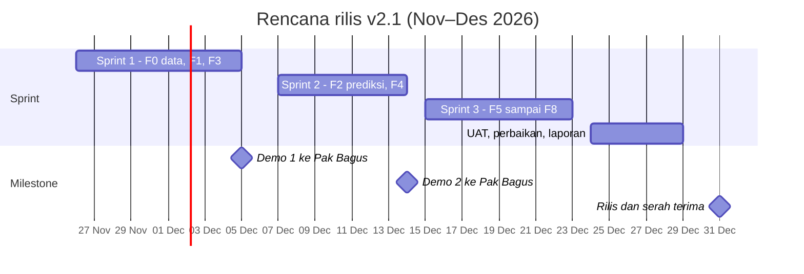

# PRD REVISI v2.1 — Zonasi Risiko & Prediksi Bird Strike
## Wildlife Hazard Management System (Portal Satwa Liar) — Bandara Internasional Juanda

| Informasi Dokumen | Keterangan |
| :--- | :--- |
| **Versi** | 2.1 (revisi atas `prd.md` v2.0 dan `spec.md` 2.0.0-PROD) |
| **Tanggal** | 25 November 2026 |
| **Sumber masukan** | Notulensi revisi Pak Bagus, 6 mockup "Gridmap Operasional Monitoring Birdstrike", dokumen "Kerangka Analisis Prediktif Peluang Birdstrike" |
| **Versi kolaborasi** | [PRD di Claude Docs](https://claude.ai/artifact/4qPpEiAkJR4L1zUnFfMzQp) |
| **Aturan konflik** | Bila `prd.md`/`spec.md` berbeda dengan masukan Pak Bagus, **saran Pak Bagus yang diikuti** (lihat bagian 3) |

---

## 1. Ringkasan

Revisi ini mengubah aplikasi dari pencatat logbook menjadi alat prioritas inspeksi. Setiap grid dan titik pengamatan P1–P9 otomatis diberi warna risiko, dan sistem menghitung **peluang bird strike 0–1 per grid per slot 30 menit**. Aplikasi lama dipertahankan dan disempurnakan, bukan dibuat ulang. Target produk siap Desember 2026.

Masalah yang diselesaikan (notulensi Pak Bagus):
- Inspektor lapangan belum tahu titik mana yang harus didatangi lebih dulu.
- Persentase potensi risiko masih dihitung manual oleh Mbak Maria.
- Pimpinan butuh infografis: posisi risiko tinggi, tren populasi, jenis dominan, riwayat mitigasi.

Catatan sumber:
- Angka di mockup gridmap berlabel ilustrasi; tidak dipakai sebagai data.
- Contoh CatBoost (akurasi 89%) di dokumen kerangka prediktif dilatih dengan data simulasi; tidak dipakai sebagai acuan. Mockup React hanya diambil tata letaknya.

**Keputusan tim (25 November 2026):**
1. Rumus probabilitas dirancang sendiri mengikuti rumus baseline logistik di kerangka prediktif Pak Bagus (bagian 8 dokumen itu).
2. Gridmap tetap memakai grid aplikasi A–L × 1–29.
3. Sumber cuaca Open-Meteo (tanpa API key), bukan BMKG.
4. Model machine learning terlatih ditunda sampai data kejadian cukup; saat ini baru 1 kejadian bird strike tercatat.

---

## 2. Tujuan, Non-tujuan, dan Metrik

**Tujuan**
1. Zonasi risiko per grid dihitung otomatis dari data inspeksi (jumlah burung × jarak ke runway/approach).
2. Peluang bird strike 0–1 dihitung otomatis dan deterministik dari cuaca, jam, jumlah burung, traffic, dan tindakan pengusiran.
3. Inspektor melihat urutan prioritas titik P1–P9 dan titik kumpul teratas begitu membuka aplikasi.
4. Pimpinan mendapat statistik/infografis: tren populasi, Top 10 jenis, indeks keanekaragaman, korelasi traffic, kejadian bird strike.
5. Riwayat mitigasi dan peta attractor tercatat per bandara.

**Non-tujuan (fase ini)**
- CCTV analitik (Roboflow): hanya riset awal.
- Peta GIS bersertifikasi: gridmap wajib dikalibrasi dengan AIP/aerodrome chart sebelum dipakai operasional.
- Rollout ke ~10 bandara: fase ini hanya menyiapkan struktur `bandara_id`.
- Model ML terlatih (regresi logistik/CatBoost): setelah sekitar 50 kejadian bird strike/near-miss tercatat.

**Metrik keberhasilan**

| Metrik | Target |
| :--- | :--- |
| Persentase risiko yang masih dihitung manual | 0% |
| Waktu dari simpan laporan sampai prediksi grid ter-update | ≤ 1 menit |
| Grid yang tampil dengan data hardcode | 0 |
| Hasil prediksi untuk input sama | Identik (deterministik) |
| Temuan burung yang tercatat tanpa jam | 0% (sekarang 83%) |
| Kecocokan kategori dengan penilaian ahli pada data 2026 | ≥ 80%, divalidasi bersama Pak Bagus |

---

## 3. Penyesuaian dengan `prd.md` dan `spec.md`

| Topik | `prd.md` / `spec.md` saat ini | Masukan Pak Bagus | Keputusan v2.1 |
| :--- | :--- | :--- | :--- |
| Kategori risiko | `spec.md` §4.1: matriks ICAO S × P, 4 kelas (Rendah/Sedang/Tinggi/Kritis) per laporan | Peluang 0–1 dengan 3 kelas: < 0,10 Rendah, 0,10–0,25 Sedang, > 0,25 Tinggi | **Keduanya dipakai.** Matriks ICAO tetap untuk skor per laporan dan Berita Acara. Prediksi bird strike memakai 3 kelas Pak Bagus. |
| Granularitas prediksi | Prediksi Gemini harian, satu angka untuk bandara (`config/whms_ai.php`, ambang 0,30/0,60/0,85) | Per grid/runway, jendela 15–60 menit | **Ikut Pak Bagus:** per grid per slot 30 menit, horizon 0–3 jam. Gemini hanya untuk narasi. |
| Metode prediksi | `prd.md` §9 roadmap #4: "Analisis prediktif AI/ML" (masa depan) | Baseline logit dulu; RF/XGBoost/CatBoost setelah data cukup | **Ikut Pak Bagus:** rumus logit dengan bobot pakar sekarang, ML setelah ~50 kejadian. |
| Tindakan pengusiran | `spec.md` §2.1: `master_alat_dispersal` + `penggunaan_alat_dispersal` (per laporan, tanpa jam/grid; belum dibuat) | Scare action dengan **jenis dan waktu**, dihitung 0–30 menit terakhir per grid | **Gabung:** `master_alat_dispersal` dipakai sebagai master alat; pencatatan pemakaian menjadi `tindakan_pengusiran` dengan waktu, grid, alat, jumlah, hasil. |
| Ukuran grid | `spec.md` §4.2: grid A–L × 1–29 lewat geofence (± 114 m × 92 m per sel) | Grid area runway/final ± 100 × 100 m | **Sudah sejalan.** Grid A–L × 1–29 tetap dipakai. |
| GPS → grid | `spec.md` §4.2: geofencing (belum diimplementasi di kode) | Hitungan kawanan per grid harus akurat | Masuk F0 (FR-0.8) sebagai Could. |
| Cuaca | `kondisi_cuaca` dropdown manual | Per 5–15 menit: hujan, visibilitas, angin (head/tail/cross), gust, suhu | Open-Meteo: widget + isi otomatis (sudah ada), snapshot server 15 menit dengan angin silang terhadap RWY 10/28 (F0). |
| Insiden | `histori_birdstrike` hanya bird strike | Bird strike **dan near-miss**, ketinggian, jarak centerline | Tambah `jenis_kejadian`, ketinggian, jarak centerline. |
| Statistik | `prd.md` Modul 4: sebaran spasial | Infografis untuk pimpinan | Sudah ada di dashboard admin (F6). |

Catatan: rumus matriks ICAO di `spec.md` §4.1 (S = 0,6 × spesies + 0,4 × area) tidak sama dengan `IcaoRiskMatrixService` di kode (matriks zona × spesies). Ini perbedaan lama, bukan bagian revisi Pak Bagus; perlu diputuskan mana yang benar sebelum `spec.md` diperbarui.

---

## 4. Kondisi Saat Ini

| Kebutuhan | Yang sudah ada | Gap |
| :--- | :--- | :--- |
| Heatmap zonasi grid | Grid A–L × 1–29 (`GridCode`), peta di `admin/statistik` | Warna dari frekuensi laporan saja; data baseline hardcode di `StatistikController` |
| Peluang bird strike | Prediksi Gemini harian (`prediksi_birdstrike_ai`) | Tidak deterministik, tidak per grid/slot |
| Cuaca | Widget Open-Meteo + isi otomatis dropdown (form & dashboard pegawai); `OpenMeteoProvider` untuk AI | Belum disimpan ke laporan; jarak pandang ditulis tetap 10 km di kode; belum ada angin silang |
| Observasi kawanan | Jenis, jumlah, grid, jam | 1.043 dari 1.250 ekor (83%) tanpa jam; arah terbang, ketinggian, perilaku belum terstruktur |
| Tindakan pengusiran | Teks bebas `tindak_lanjut` / `detail_pengusiran` | Tidak ada jenis dan jam terstruktur |
| Insiden | `histori_birdstrike` (1 baris) | Near-miss, ketinggian, jarak centerline |
| Traffic | `kepadatan_penerbangan` per jam, take-off/landing terpisah; 6.552 slot dari movement sheet AMC | Data Feb 2026 hanya penerbangan internasional; Okt 2026 dst. belum ada |
| P1–P9, attractor, mitigasi | Belum ada | Master data + peta |
| Statistik | `BirdStatisticsService` + dashboard admin (KPI, tren, Top 10, keanekaragaman, aktivitas grid, jam, kejadian, korelasi) | — |

---

## 5. Ruang Lingkup dan Prioritas

| ID | Fitur | Prioritas | Status 26 Nov 2026 |
| :--- | :--- | :--- | :--- |
| F0 | Kelengkapan data prediksi (jam wajib, perilaku kawanan, log pengusiran, near-miss, snapshot cuaca) | Must | Selesai (FR-0.1–0.7); FR-0.8 (Could) belum |
| F1 | Gridmap heatmap risiko otomatis (jumlah × jarak runway) | Must | Sebagian (heatmap frekuensi) |
| F2 | Peluang bird strike per grid per slot 30 menit + kategori + aksi | Must | Belum (Gemini harian masih berjalan) |
| F3 | Titik pengamatan P1–P9 + popup titik kumpul | Must | Belum |
| F4 | Cuaca otomatis (Open-Meteo) | Should | Sebagian (widget + isi otomatis) |
| F5 | Traffic take-off/landing + korelasi | Should | Sebagian (data AMC Jan 2022 & Feb–Sep 2026 diimpor; Feb hanya internasional) |
| F6 | Statistik & infografis | Should | Selesai |
| F7 | Menu mitigasi per bandara | Should | Belum |
| F8 | Pemetaan attractor | Could | Belum |
| F9 | Struktur multi-bandara | Could | Belum |
| F10 | Riset CCTV analitik | Won't (fase ini) | — |

---

## 6. Kebutuhan Fungsional

### F0 — Kelengkapan data prediksi
- **FR-0.1** Jam pengamatan wajib di form inspeksi (default jam sekarang, bisa dikoreksi).
- **FR-0.2** Detail satwa: perilaku (terbang melintas, mencari makan, bertengger), arah terbang (8 mata angin), ketinggian (< 50 ft, 50–200 ft, > 200 ft).
- **FR-0.3** Log tindakan pengusiran: waktu, grid, alat (dari `master_alat_dispersal`: sirene, pyro, laser, patroli kendaraan, lainnya), jumlah, hasil.
- **FR-0.4** Near-miss dan bird strike memakai form yang sama (`histori_birdstrike.jenis_kejadian`), plus ketinggian dan jarak centerline bila diketahui.
- **FR-0.5** Snapshot cuaca server per 15 menit dari Open-Meteo: hujan, jarak pandang, arah/kecepatan angin, hembusan, suhu, kelembapan, tutupan awan; angin silang terhadap heading RWY 10/28.
- **FR-0.6** Traffic take-off/landing per jam (lihat F5).
- **FR-0.7** Peringatan kualitas data bila cuaca atau observasi kosong lebih dari 2 interval berturut-turut.
- **FR-0.8** (Could) GPS perangkat → kode grid memakai geofencing `spec.md` §4.2.

### F1 — Gridmap heatmap risiko
- **FR-1.1** Atribut per grid A–L × 1–29: zona, jarak ke runway (m), di kerucut approach/departure, runway terdekat.
- **FR-1.2** Skor zonasi = rata-rata ekor per pengamatan × W_jarak × W_spesies × W_attractor (bagian 7.1).
- **FR-1.3** 4 warna (hijau/kuning/oranye/merah); grid tanpa data tampil netral.
- **FR-1.4** Ambang dapat diubah admin tanpa deploy; legenda menampilkan batas.
- **FR-1.5** Data baseline hardcode di `StatistikController` dihapus.

### F2 — Peluang bird strike
- **FR-2.1** Unit prediksi = (slot 30 menit, grid, runway); slot sekarang sampai 3 jam ke depan.
- **FR-2.2** Rumus baseline logistik bagian 7.2, bobot di config; tanpa Gemini.
- **FR-2.3** Hitung ulang tiap 15 menit (scheduler) dan segera setelah laporan/tindakan pengusiran disimpan atau disinkronkan.
- **FR-2.4** Kategori dan aksi mengikuti bagian 7.3.
- **FR-2.5** Simpan kontribusi tiap variabel (β·x) sebagai panel "faktor penyumbang".
- **FR-2.6** Dashboard: heatmap slot sekarang, timeline 0–3 jam per runway, panel faktor, tombol aksi cepat (patroli, pyro/laser, pesan standar ke ATC/Apron) yang tercatat ke log pengusiran.
- **FR-2.7** Gemini hanya untuk narasi ringkasan.
- **FR-2.8** Uji balik bulanan: % kejadian di 10% slot risiko tertinggi, median jeda alarm→kejadian, alarm palsu per jam.

### F3 — Titik pengamatan P1–P9 dan titik kumpul
- **FR-3.1** Master P1–P9: kode, nama, grid, fokus, cakupan grid.
- **FR-3.2** Form inspeksi: pilihan titik pengamatan (otomatis dari grid terdekat).
- **FR-3.3** Marker P1–P9 berwarna sesuai risiko tertinggi di cakupannya + daftar "Kunjungi hari ini".
- **FR-3.4** Hotspot otomatis dengan popup jumlah ekor; Top 10 hotspot dan 5 coldspot.

### F4 — Cuaca otomatis
- **FR-4.1** Open-Meteo tanpa API key.
- **FR-4.2** Sudah ada: widget "Cuaca Saat Ini" (Geolocation, fallback Surabaya, cache 15 menit), dropdown Kondisi Cuaca terisi otomatis.
- **FR-4.3** Simpan suhu, kelembapan, angin, kode cuaca ke laporan.
- **FR-4.4** Laporan tetap bisa disimpan offline dengan cuaca manual.

### F5 — Traffic & korelasi
- **FR-5.1** `jumlah_takeoff` dan `jumlah_landing` per jam; template import diperbarui.
- **FR-5.2** Scatter traffic vs burung per hari dengan Pearson r (sudah ada di dashboard).
- **FR-5.3** Peringatan bila sampel < 30 hari (sudah ada).

### F6 — Statistik & infografis (selesai)
KPI, tren bulanan, Top 10 jenis, indeks Shannon/Simpson/Pielou, distribusi aktivitas grid, jam temuan, kejadian per fase/waktu, korelasi traffic. Sisa: ekspor PDF untuk pimpinan.

### F7 — Mitigasi
- **FR-7.1** CRUD mitigasi per bandara: tanggal, grid/titik, jenis (pengelolaan habitat, pembersihan, dll.), petugas, hasil, foto.
- **FR-7.2** Tautan ke laporan/hotspot; status hotspot "Ditangani".
- **FR-7.3** Riwayat per grid + efektivitas (ekor 7 hari sebelum vs sesudah).

### F8 — Attractor
- **FR-8.1** Master attractor: jenis (wetland, tambak, rumput, sawah, sampah, pohon), grid, status, foto.
- **FR-8.2** Layer peta yang bisa dinyalakan/dimatikan.
- **FR-8.3** Attractor aktif menambah bobot skor zonasi grid sekitarnya.

---

## 7. Model Risiko

### 7.1 Skor zonasi grid (F1)

$$S_{grid} = \bar{N} \times W_{jarak} \times W_{spesies} \times W_{attractor}$$

- N̄ = rata-rata ekor per pengamatan di grid dalam jendela waktu.
- W_spesies = 1,0 burung kecil; 1,5 sedang; 2,0 besar/berkelompok (cangak, kuntul, blekok, elang).
- W_attractor = 1,2 bila ada attractor aktif di grid/tetangganya, selain itu 1,0.

| Zona | W_jarak |
| :--- | :--- |
| Runway strip / kerucut approach-departure, ≤ 300 m | 3,0 |
| 300–1.000 m | 1,0 |
| 1.000–2.000 m | 0,3 |
| > 2.000 m | 0,1 |

| Kelas | Warna | Batas S_grid |
| :--- | :--- | :--- |
| Rendah | Hijau | < 3 |
| Sedang | Kuning | 3 – < 9 |
| Tinggi | Oranye | 9 – < 15 |
| Sangat Tinggi | Merah | ≥ 15 |

Mode **Aktivitas** (total ekor per grid 6 bulan: ≤ 50 / 51–150 / 151–300 / > 300) sudah dipakai di dashboard admin.

### 7.2 Peluang bird strike (F2): rumus baseline logistik

$$\text{logit}(p) = \beta_0 + \beta_1 x_{hujan} + \beta_2 x_{angin} + \beta_3 x_{traffic} + \beta_4 x_{kawanan} + \beta_5 x_{pengusiran} + \beta_6 x_{jam}$$

$$p = \frac{1}{1 + e^{-\text{logit}(p)}}$$

| Variabel | Definisi x | Sumber | β awal |
| :--- | :--- | :--- | :--- |
| Konstanta | — | — | −5,0 |
| Hujan | 1 bila hujan ringan–sedang pada slot | `cuaca_snapshot` | +0,4 |
| Angin silang | Komponen angin tegak lurus RWY 10/28 (kt) ÷ 10 | `cuaca_snapshot` | +0,3 |
| Traffic | Pergerakan per jam ÷ 10 | `kepadatan_penerbangan` | +0,3 |
| Kawanan | ln(1 + S_30m); S_30m = Σ ekor × W_jarak × W_spesies, 30 menit terakhir di grid | Laporan inspeksi | +1,2 |
| Pengusiran | 1 bila ada tindakan pengusiran di grid 30 menit terakhir | `tindakan_pengusiran` | −0,7 |
| Jam aktif | 1 bila slot di 05.00–08.00 atau 16.00–18.00 WIB | Jam slot | +0,5 |

β awal adalah **usulan tim, belum disetujui Pak Bagus**.

| Contoh (burung kecil) | p | Kategori |
| :--- | :--- | :--- |
| Tanpa burung, hujan, angin silang 15 kt, 15 pergerakan/jam, jam aktif | 0,04 | Rendah |
| 20 ekor di area > 2 km, jam aktif, 10 pergerakan/jam | 0,05 | Rendah |
| 2 ekor dekat runway, jam aktif, 10 pergerakan/jam | 0,13 | Sedang |
| 6 ekor dekat runway, jam aktif, 10 pergerakan/jam | 0,34 | Tinggi |
| Sama, tetapi sudah diusir 30 menit terakhir | 0,20 | Sedang |

Slot ke depan: cuaca dari prakiraan per jam Open-Meteo, traffic dari rata-rata jam yang sama 4 minggu terakhir, S_30m meluruh setengah tiap 60 menit sejak observasi terakhir (laju di config).

### 7.3 Ambang dan aksi (dari kerangka Pak Bagus)

| p | Kategori | Aksi |
| :--- | :--- | :--- |
| < 0,10 | Rendah | Patroli rutin |
| 0,10–0,25 | Sedang | Vehicle sweep RWY/RESA, pengusiran ringan |
| > 0,25 | Tinggi | Koordinasi ATC untuk runway inspection; tunda 5–10 menit bila kawanan aktif; pyro/laser terarah |

Ambang disetel ulang berdasarkan biaya alarm palsu vs kejadian terlewat dan kapasitas tim WHM.

### 7.4 Kalibrasi
1. Sekarang: β pakar di `config/whms_risk.php`, diuji ke data 2026 dan dibandingkan dengan penilaian manual Mbak Maria.
2. Setelah ~50 kejadian/near-miss: regresi logistik offline (Python), split berdasarkan waktu, class weights, kalibrasi Platt/isotonic; evaluasi AUC-PR, Brier, Lift@Top-10%. β baru ditulis ke config.
3. RF/XGBoost/CatBoost setelah regresi logistik berjalan.
4. Kalibrasi ulang tiap 1–3 bulan; audit variabel setiap bird strike.

---

## 8. Perubahan Model Data

Rincian kolom ada di `spec.md` §9.

| Tabel | Status | Dipakai oleh |
| :--- | :--- | :--- |
| `master_alat_dispersal` | Baru (dari `spec.md`) | F0, F2 |
| `tindakan_pengusiran` | Baru (menggantikan `penggunaan_alat_dispersal` di `spec.md`) | F0, F2 |
| `cuaca_snapshot` | Baru | F0, F2, F4 |
| `grid_cell` | Baru | F1, F2 |
| `titik_pengamatan` | Baru | F3 |
| `prediksi_risiko_slot` | Baru (cache) | F2 |
| `skor_risiko_grid` | Baru (cache) | F1 |
| `mitigasi`, `attractor`, `bandara` | Baru | F7, F8, F9 |
| `laporan` | Ubah: jam wajib, cuaca terstruktur, titik pengamatan | F0, F3, F4 |
| `detail_satwa` | Ubah: perilaku, arah terbang, ketinggian | F0, F2 |
| `histori_birdstrike` | Ubah: jenis kejadian, ketinggian, jarak centerline, grid | F0 |
| `kepadatan_penerbangan` | Ubah: take-off/landing | F5, F2 |
| `jenis_satwa` | Ubah: ukuran, berkelompok | F1, F2 |

---

## 9. Kriteria Penerimaan (demo ke Pak Bagus)

- [ ] Peta tidak menampilkan data hardcode.
- [ ] Laporan 6 ekor di grid dekat threshold RWY 10 pada jam aktif membuat grid itu Tinggi (p > 0,25) dan P1 naik ke urutan teratas.
- [ ] Peluang tampil 0–1 dengan panel faktor penyumbang dan timeline 0–3 jam, tanpa input manual.
- [ ] Tombol aksi cepat mencatat tindakan pengusiran dan menurunkan risiko slot berikutnya.
- [x] Cuaca form terisi otomatis (Open-Meteo).
- [x] Dashboard admin: Top 10 jenis, tren bulanan, indeks keanekaragaman, korelasi traffic, distribusi fase kejadian.
- [ ] Mitigasi tercatat dan riwayatnya per grid terlihat.
- [ ] Layer attractor tampil di peta.

---

## 10. Rencana Rilis

---

## 11. Pertanyaan Terbuka dan Risiko

**Pertanyaan untuk Pak Bagus / tim bandara**
- [ ] Apakah β awal dan ambang 0,10/0,25 disetujui sebagai titik awal?
- [ ] Grid pasti P1–P9 dan grid ujung threshold RWY 10/28 (perlu aerodrome chart).
- [ ] Apakah ada catatan near-miss dan tindakan pengusiran masa lalu yang bisa diimpor?
- [ ] Kapasitas tim WHM per jam (untuk membatasi alarm Tinggi).
- [ ] Jadwal penerbangan ke depan tersedia, atau cukup rata-rata historis?
- [ ] Jam aktif burung 05.00–08.00 dan 16.00–18.00 WIB sesuai pengamatan lapangan?
- [ ] Format database traffic: per jam atau per penerbangan?
- [ ] Konfirmasi angka kejadian 66% landing dan 21% take-off.
- [ ] Nama resmi aplikasi web.

**Risiko**

| Risiko | Dampak | Mitigasi |
| :--- | :--- | :--- |
| Data kejadian baru 1 bird strike | Model ML tidak bisa dilatih; β belum tervalidasi | β pakar; catat near-miss; latih setelah ~50 kejadian |
| 83% temuan tanpa jam | Variabel kawanan dan jam aktif kosong | Jam wajib (FR-0.1) |
| Pengusiran teks bebas | Efek pengusiran tidak terukur | Log terstruktur + tombol aksi cepat |
| Terlalu banyak alarm Tinggi | Tim kewalahan, alarm diabaikan | Setel ambang ke kapasitas tim; uji balik |
| Open-Meteo tidak bisa dihubungi | Variabel cuaca kosong | Snapshot terakhir; variabel cuaca netral (x = 0) |
| Waktu ± 5 minggu | Fitur Should/Could tidak selesai | Kunci F0–F3; F4–F8 bertahap |
